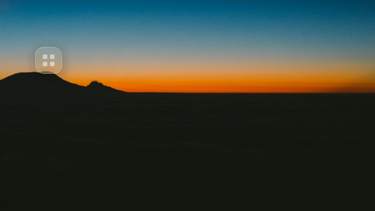
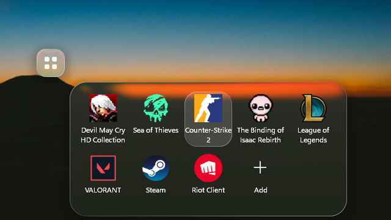
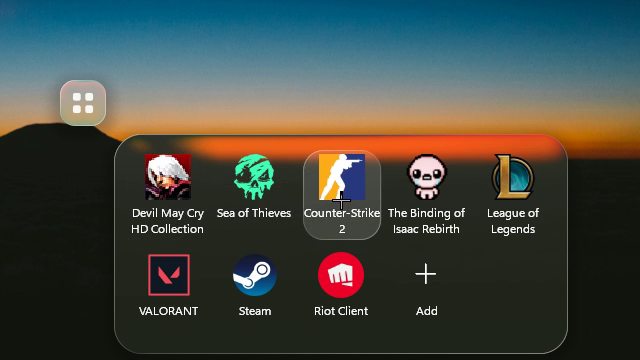

<div align="center">


# DESKTOUCH

**Your shortcuts, right on your desktop.**

A small glass square that lives on your Windows desktop, AssistiveTouch-style: hover it and a panel of shortcuts flows out of it like a drop.


▶ [Watch the 16 s presentation video](docs/media/desktouch.mp4)

**[Download the latest release](https://github.com/DanyalRez/DESK-TOUCH/releases/latest)**

</div>

---

## What it does

<table>
<tr>
<td width="50%"></td>
<td width="50%"></td>
</tr>
<tr>
<td><b>Out of the way.</b> A glass square at the opacity you choose, sitting on your wallpaper like an icon: under every window, still there after Win + D.</td>
<td><b>Hover, and it opens.</b> The panel flows out of the square with the real logos of your apps and games. One click launches them.</td>
</tr>
<tr>
<td></td>
<td></td>
</tr>
<tr>
<td><b>Your way.</b> Drag a tile to reorder; drag the square anywhere, even to another screen.</td>
<td><b>Three themes.</b> Liquid Glass, Dark or Light, plus icon size, columns, names and opacity.</td>
</tr>
</table>

## Install

1. Download **`DESKTOUCH.exe`** from the [latest release](https://github.com/DanyalRez/DESK-TOUCH/releases/latest).
2. Run it. DESKTOUCH installs itself in `%LOCALAPPDATA%\DESKTOUCH`, adds a Start menu entry, starts with Windows (you can turn that off) and creates a few example shortcuts.

That's it: no installer, no admin rights. Windows SmartScreen may warn about an unknown publisher the first time (the app isn't code-signed): *More info → Run anyway*.

### Updates

**Settings → Updates → Check.** If a newer release exists, the button turns into **Install vX.Y.Z**: one click downloads it, swaps the app and restarts it. DESKTOUCH also checks quietly once at each launch.

## Use

| Gesture | Effect |
| --- | --- |
| Hover the square | the panel opens (or on click, see settings) |
| Click a tile | launches the app |
| Drag a tile | reorders |
| Press the square and move | moves it (position is remembered) |
| **Add** (last tile) | pick an app, shortcut or game in the Open dialog |
| Right-click a tile | remove it |
| Right-click elsewhere | menu |

### Settings

Click the DESKTOUCH icon in the taskbar's **hidden icons** (right-click for the menu).

- **Theme**: Liquid Glass, Dark, Light
- **Icon size**: small, medium, large
- **Columns**: 3 to 6
- **Panel opens**: on hover or on click
- **Logo opacity** on the desktop
- **Show names** (on two lines, never cut off)
- **Launch at startup**
- **Logo position**: reset
- **Updates**: check and install

## Under the hood

- **Native Rust**, a single dependency (`windows-sys`), a ~350 KB executable.
- **Home-made liquid glass**: the background is captured and blurred, a lens refracts the edges, colours split slightly in the corners, a light rim follows the shape. The square and the panel merge like two drops before they separate.
- **Spring animations** paced to your screen's refresh rate; **nothing runs at rest**.
- **Sharp on high-DPI screens**: rendered at native resolution, 256 px app logos.

## Build from source

```bash
cargo build --release
target/release/desktouch.exe
```

Needs Rust with the `x86_64-pc-windows-gnu` target and MinGW (`windres` embeds the icon). A build run from a `target` folder doesn't install itself, to keep development simple.

## Files next to the executable

- `Shortcuts/`: the panel's shortcuts (`.lnk`, `.url`)
- `settings.txt`, `position.txt`, `order.txt`: settings, square position, tile order

## Credits

- Glass recipe adapted from [AndroidLiquidGlass](https://github.com/Kyant0/AndroidLiquidGlass) (Kyant, Apache-2.0).
- Logo: `assets/desktouch.svg` (source), `assets/desktouch.ico` (16 to 256 px); explored directions in `docs/logo/`.
- Video: made with [HyperFrames](https://hyperframes.heygen.com) (`video/`) from real recordings of the app; UI sounds from Pixabay (`video/assets/sfx/CREDITS.md`).
