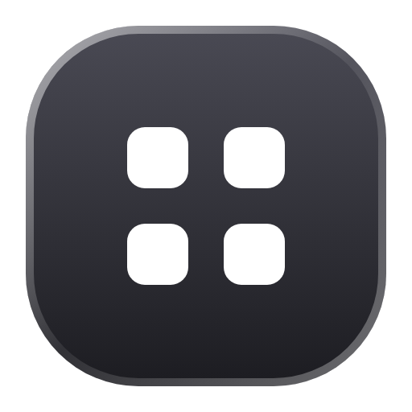
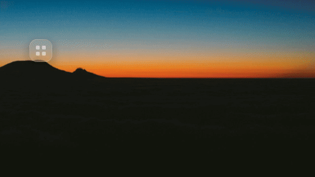
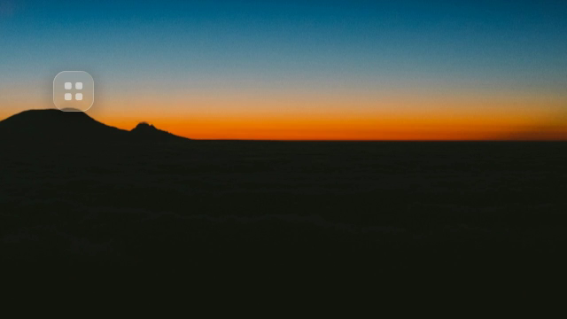
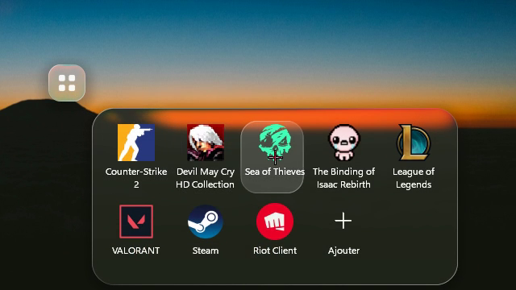
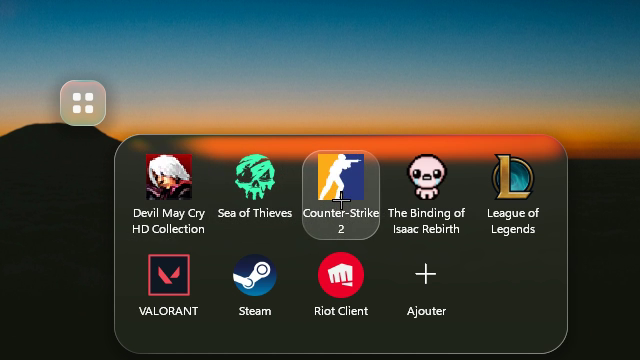
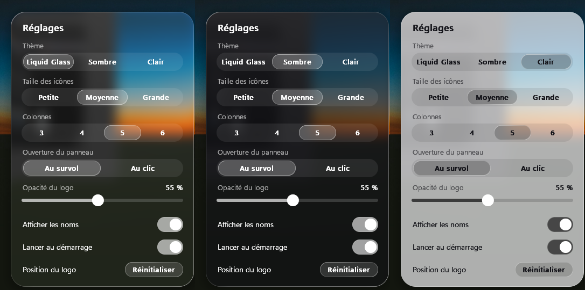

<div align="center">



# DESKTOUCH

**Tes raccourcis, posés sur ton bureau.**

Un petit carré de verre sur le bureau Windows, façon AssistiveTouch : au survol, un panneau de raccourcis en sort comme une goutte.




▶ [Vidéo de présentation (16 s)](docs/media/desktouch.mp4)

</div>

---

## Ce qu'il fait

<table>
<tr>
<td width="50%"></td>
<td width="50%"></td>
</tr>
<tr>
<td><b>Discret.</b> Un carré de verre, à l'opacité de ton choix, posé sur le fond d'écran comme une icône : sous toutes les fenêtres, toujours là avec Win + D.</td>
<td><b>Au survol, il s'ouvre.</b> Le panneau sort du carré comme une goutte, avec les vrais logos de tes applis et jeux. Un clic les lance.</td>
</tr>
<tr>
<td></td>
<td></td>
</tr>
<tr>
<td><b>À ta façon.</b> Glisse une tuile pour changer l'ordre ; déplace le carré où tu veux, même sur un autre écran.</td>
<td><b>Trois thèmes.</b> Liquid Glass, Sombre ou Clair, plus la taille des icônes, les colonnes, les noms et l'opacité.</td>
</tr>
</table>

## Installer

```bash
cargo build --release
target/release/desktouch.exe
```

Il faut Rust (cible `x86_64-pc-windows-gnu`, MinGW pour `windres` qui intègre l'icône). Au premier lancement, DESKTOUCH s'inscrit au démarrage de Windows (désactivable dans les réglages) et crée quelques raccourcis d'exemple.

## Utiliser

| Geste | Effet |
| --- | --- |
| Survol du carré | le panneau s'ouvre (ou au clic, selon le réglage) |
| Clic sur une tuile | lance l'appli |
| Glisser une tuile | change l'ordre |
| Appuyer sur le carré et bouger | le déplace (position gardée) |
| **Ajouter** (dernière tuile) | choisis une appli, un raccourci ou un jeu dans la fenêtre « Ouvrir » |
| Clic droit sur une tuile | la retirer |
| Clic droit ailleurs | menu |

### Réglages

Clic sur l'icône DESKTOUCH dans les **icônes cachées** de la barre des tâches (clic droit : menu).

- **Thème** : Liquid Glass, Sombre, Clair
- **Taille des icônes** : petite, moyenne, grande
- **Colonnes** : 3 à 6
- **Ouverture du panneau** : au survol ou au clic
- **Opacité du logo** sur le bureau
- **Afficher les noms** (sur deux lignes, jamais coupés)
- **Lancer au démarrage**
- **Position du logo** : réinitialiser

## Sous le capot

- **Rust natif**, une seule dépendance (`windows-sys`) ; un exe d'environ 350 Ko.
- **Verre liquide calculé maison** : le fond est capturé puis flouté, une lentille réfracte les bords, les couleurs se décomposent légèrement dans les coins, un liseré lumineux suit la forme. Le carré et le panneau fusionnent comme deux gouttes avant de se séparer.
- **Animations à ressort** cadencées sur la fréquence de l'écran ; **rien ne tourne au repos**.
- **Net en haute définition** : rendu à la résolution native, logos en 256 px.

## Fichiers à côté de l'exe

- `Raccourcis/` : les raccourcis du panneau (`.lnk`, `.url`)
- `reglages.txt`, `position.txt`, `ordre.txt` : réglages, position du carré, ordre des tuiles

## Crédits

- Recette du verre adaptée d'[AndroidLiquidGlass](https://github.com/Kyant0/AndroidLiquidGlass) (Kyant, Apache-2.0).
- Logo : `assets/desktouch.svg` (source), `assets/desktouch.ico` (16 à 256 px) ; pistes explorées dans `docs/logo/`.
- Vidéo : faite avec [HyperFrames](https://hyperframes.heygen.com) (`video/`), à partir de vraies prises de l'app ; sons d'interface Pixabay (`video/assets/sfx/CREDITS.md`).
